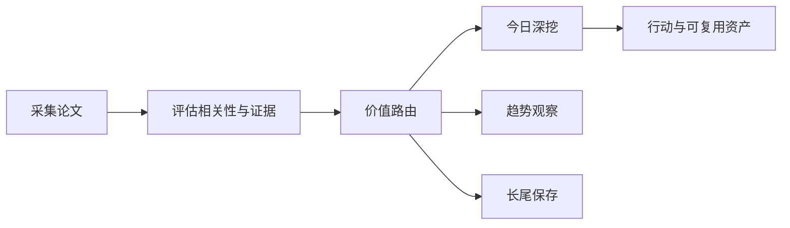

# 前沿理论驱动技术雷达

<h3 align="center">用可追溯证据判断：哪些前沿 AI 论文现在值得行动、哪些值得观察、哪些应当暂缓。</h3>

<p align="center">
  每日完成论文采集、价值路由、深度判断与趋势沉淀，区分即时价值、趋势价值、长尾价值与噪声。
</p>

<p align="center">
  <a href="README.md">English</a> ·
  <a href="https://radar.aiutil.com">在线雷达</a> ·
  <a href="https://radar.aiutil.com/daily.html">日报</a> ·
  <a href="https://radar.aiutil.com/about.html">研究方法</a>
</p>

<p align="center">
  <a href="https://github.com/aiutil/frontier-theory-radar/actions/workflows/ci.yml"></a>
  <a href="LICENSE"></a>
  
</p>


## 最新研究 · 2026-10-20

| 审阅论文 | 即时价值 | 趋势价值 | 长尾价值 | 暂时忽略 |
| ---: | ---: | ---: | ---: | ---: |
| 10 | 144 | 236 | 244 | 1356 |

**今日深挖：** [Self-Building Labs](daily/2026/2026-10-20.md) · 即时价值 · 重点学习

**核心判断：** 据摘要（arXiv 2610.23826），这篇把 SDL 从 '运行人类设计的流程' 推到 'design, configures, and operates its own laboratory setup'——即让 agent 自己设计 / 配置 / 运维整个实验台，明确点出 'existing SDLs can only run the procedures they were built for. Adapting them to a new experiment still takes extensive manual engineering, which makes laboratory flexibility the bottleneck for scaling discovery'。这是 ai-agent × multimodal-agent × ai-k8s-platform 的 'self-reconfiguring SDL / lab-as-agent' 直接路线资产；与昨日 CoDA（2610.22362 data × policy co-evolution）、DiscoveryRSI（2610.23839 hypothesis-tree RSI）一起构成 'agent4science / agent4SDL' 主线——若 SBL 公开 lab reconfiguration 协议与跨硬件 interface，会成为团队日后做 '内部 self-reconfiguring eval rig' / 'lab-reconfig agent skill' 的直接底座。

**建议动作：** 把 Self-Building Labs（[2610.23826](http://arxiv.org/abs/2610.23826)）列为即时试点方向；为 SEER-Repro（[2610.23845](http://arxiv.org/abs/2610.23845)）建立即时试点卡片（与 SBL 一起构成 'lab-as-agent + reproducibility-agent' 即时双线）；为 DiscoveryRSI（[2610.23839](http://arxiv.org/abs/2610.23839)）、Behavioral Couplings（[2610.23847](http://arxiv.org/abs/2610.23847)）、ReDiST（[2610.23831](http://arxiv.org/abs/2610.23831)）建立/更新趋势卡片（hypothesis RSI / behavioral coupling / learner-conditioned distillation 主线加固）；为 MFlow（[2610.23854](http://arxiv.org/abs/2610.23854)）、QoT in Quantum Networks（[2610.23827](http://arxiv.org/abs/2610.23827)）、ENFR（[2610.23825](http://arxiv.org/abs/2610.23825)）、Spectral Inductive Biases in PQC（[2610.23834](http://arxiv.org/abs/2610.23834)）、Waiting Buys Exactly Two Moments（[2610.23830](http://arxiv.org/abs/2610.23830)）保持/新增长尾卡片。


## 最近 7 期日报

| 日期 | 深挖论文 | 价值类型 | 判断 |
| --- | --- | --- | --- |
| [2026-10-20](daily/2026/2026-10-20.md) | Self-Building Labs | 即时价值 | 重点学习 |
| [2026-10-19](daily/2026/2026-10-19.md) | MLExpert: Towards a Generalist Agentic Model for Autonomous Machine Learning Engineering | 即时价值 | 重点学习 |
| [2026-10-18](daily/2026/2026-10-18.md) | MLExpert: Towards a Generalist Agentic Model for Autonomous Machine Learning Engineering | 即时价值 | 轻量试点 |
| [2026-10-17](daily/2026/2026-10-17.md) | The World Won't Wait: Evaluating and Teaching Agents Under a Live Clock | 即时价值 | 轻量试点 |
| [2026-10-16](daily/2026/2026-10-16.md) | Co-Evolving Acting and Forecasting for Language Agents | 即时价值 | 轻量试点 |
| [2026-10-15](daily/2026/2026-10-15.md) | Hybrid Reasoning Agents | 即时价值 | 轻量试点 |
| [2026-10-14](daily/2026/2026-10-14.md) | RSI-Anything: Unlocking Recursive Self-Improvement with World Models | 即时价值 | 轻量试点 |

## 当前重点趋势

| 方向 | 阶段 | 关联论文 |
| --- | --- | ---: |
| [Agentic World Modeling](https://radar.aiutil.com/trend-detail.html?id=agentic-world-modeling) | 上升 | 609 |
| [Coding Agent](https://radar.aiutil.com/trend-detail.html?id=coding-agent) | 主流化 | 614 |
| [Context Engineering](https://radar.aiutil.com/trend-detail.html?id=context-engineering) | 上升 | 609 |

## 为什么做这个项目

论文聚合站通常优化“新”和“热”，本项目优化“判断”：哪些值得今天试验，哪些需要连续观察，哪些虽然不热但应该保留，哪些证据不足应明确暂缓。每个结论都保留来源，并写清当前最大不确定性。

## 研究工作流



- `papers/`：按日期保存来源快照和评分候选。
- `daily/`：保存每次研究运行的人类可读判断记录。
- `trends/`、`insights/`：沉淀跨日趋势与可复用发现。
- `docs/data/`：在线站点使用的结构化公开投影。
- `scripts/generate_readme.py`：从已提交证据生成双语 README 和活动图表。

## 证据边界

评分与结论属于研究判断，不等于独立复现。论文摘要、作者自述 Benchmark、开源实现与第三方复现是不同证据等级。代码缺失、摘要截断或 Benchmark 未核验时，会明确标注，不把推断包装成事实。

## 本地运行与验证

```bash
./run_daily.sh 2026-08-07
python3 -m pytest tests
python3 scripts/generate_readme.py
```

生产定时任务运行在 AIUtil 私有自动化环境中，凭据和私有运行记忆不进入本仓库。生成后的 Markdown、SVG、JSON 和来源链接均可通过 Git 历史审阅。

## 安全

请勿提交数据源凭据、API Token、私有论文集合或运营记忆。安全问题请通过 [GitHub Security Advisories](https://github.com/aiutil/frontier-theory-radar/security/advisories/new) 私下报告。

## 开源协议

Apache License 2.0，详见 [NOTICE](NOTICE)。
