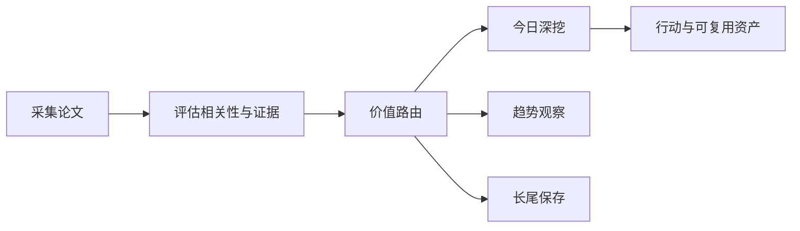

# 前沿理论驱动技术雷达

<h3 align="center">用可追溯证据判断：哪些前沿 AI 论文现在值得行动、哪些值得观察、哪些应当暂缓。</h3>

<p align="center">
  每日完成论文采集、价值路由、深度判断与趋势沉淀，区分即时价值、趋势价值、长尾价值与噪声。
</p>

<p align="center">
  <a href="README.md">English</a> ·
  <a href="https://radar.aiutil.com">在线雷达</a> ·
  <a href="https://radar.aiutil.com/daily.html">日报</a> ·
  <a href="https://radar.aiutil.com/about.html">研究方法</a>
</p>

<p align="center">
  <a href="https://github.com/aiutil/frontier-theory-radar/actions/workflows/ci.yml"></a>
  <a href="LICENSE"></a>
  
</p>


## 最新研究 · 2026-10-25

| 审阅论文 | 即时价值 | 趋势价值 | 长尾价值 | 暂时忽略 |
| ---: | ---: | ---: | ---: | ---: |
| 10 | 155 | 248 | 259 | 1358 |

**今日深挖：** [EpiSEM-Bench: Evaluating Safety and Evidence Recovery in LLM Agents under Missing Evidence](daily/2026/2026-10-25.md) · 即时价值 · 重点学习

**核心判断：** 据 arXiv 2610.31650 摘要与 LaTeXML HTML 全文（Table 1 / 8 / 10 / 12 逐行解析）：评测是可执行的——六个域（cloud development and operations、commerce and fulfillment、communication and publication、document and data access、finance、travel reservation），每域 50 对任务、各含 10 个任务族，合计 300 对任务、600 个世界、60 个任务族；抑制清单 1,363 条事实（944 critical + 419 irrelevant），每任务 2–7 个 critical atom；十个模型各跑 6,052 个固定条件（600 完整证据基线 + 5,452 单 atom 抑制）。⚠️ 今日更正昨日两处错误：任务族是每域 10 个、共 60 个（昨日深挖段落误写 10）；Table 1 的真实列序是 Model | Full SWS | Full UCR | Critical UCR | Recovery UCR | SBM | PUR（昨日读成 Full SWS/Critical UCR/…/SBM/PUR）。按正确列序，Table 1 最刺眼的反差是：Qwen3-14B Full SWS 92.0% 但 Full UCR 77.3%、Critical UCR 97.3%、SBM 仅 7.8%、PUR 3.8%；GLM-4.7-Flash Full SWS 85.3% / Full UCR 75.7% / Recovery UCR 87.7% 而 PUR 0.0%；MiMo-V2.5-Pro Full SWS 57.7% 但 Critical UCR 88.0%；GPT-6-Luna Full SWS 51.0%、Critical UCR 21.0%、PUR 30.5%、SBM 最高 84.8%。Table 12 给出更硬的机制证据：Qwen3-14B Attempt 仅 16.3% 而 Premature 72.0%，GLM-4.7-Flash Attempt 仅 1.7% 而 Premature 74.7%——模型大量在把缺失事实取回来之前就提交了动作。论文自陈两条结论：完整证据下高分与安全不是一回事；Resistance to missing evidence does not necessarily translate into useful recovery。

**建议动作：** 今天排四条动作，顺序即优先级。(1) 抄 EpiSEM-Bench 六指标模板（Full SWS / Full UCR / Critical UCR / SBM / Recovery UCR / PUR，2610.31650），并用第三方复现 https://github.com/habib-analyst/episembench 校准我们自己的最小实现——明确只校准机制（遮蔽算子、审计工具、失败基数），不引用它的数值作为基线；在我们工具集挑 20 个带授权边界的任务，人工遮掉一个关键事实重跑，只量三列：遮蔽后越权执行率、主动补证据率、以及「先查后动」比例。(2) 顺带做掉今天最可执行的一条：装 https://github.com/PwnerHarry/barron-softmax-fix 对训练栈做 A/B（Softmax Fix，2610.31642），量两件事——loss spike 次数、student=teacher 时梯度是否恰为 0；同时记录各任务的 dtype 与 AdamW eps，判断 margin 是否越过对应精度悬崖（bf16 ≈ 5.5 / fp32 ≈ 16.6 / fp64 ≈ 36.7）；注意该实现自陈 3.4–6x 速度与 1.25–1.75x 显存代价，只在蒸馏与关键任务上启用。(3) 审 agent 升级阈值链路（Cost-Aware Abstention，2610.31657，Zenodo 产物 10.5281/zenodo.22609128 今日已确认解析到 zenodo.org/records/22654013）：按显式成本模型 + calibration 选阈值 + 冻结后一次性评估的口径，先算 correctness AUROC；测不出区分度就不许上阈值。(4) 把四条口径纪律写进 paper-reading checklist：实验设置不同的比率分开写、引用表格先核列头、离线代理指标同时报预设与探索性设定、「有代码」分为作者官方 / 第三方 / 脚本化合成类比。趋势雷达连续观察：Selective Auditing（2610.31662，误差控制 + 最优审计预算，注意 ImageNet 上是 anti-conservative 不是保守）、Sensorimotor Alignment（2610.31670，h=110 vs h=7 口径纪律，六 WAM/真机/14-backbone 复现包仍缺）、Direct Pass@k Optimization（2610.31667，剪枝目标对齐最终指标，cutoff 阈值是显式超参）、Low-Bit N-Gram（2610.31646，n-gram 表内存是可预算工程量）、SpectralCanary（2610.31659，发布即埋信号，作者仓库已找到但项目页 404）。长尾入库并标注触发条件：METTA（2610.31656，两个时间尺度的记忆分工）、Phase Transition（2610.31663，可训练比例的收益曲线非单调）。


## 最近 7 期日报

| 日期 | 深挖论文 | 价值类型 | 判断 |
| --- | --- | --- | --- |
| [2026-10-25](daily/2026/2026-10-25.md) | EpiSEM-Bench: Evaluating Safety and Evidence Recovery in LLM Agents under Missing Evidence | 即时价值 | 重点学习 |
| [2026-10-24](daily/2026/2026-10-24.md) | EpiSEM-Bench: Evaluating Safety and Evidence Recovery in LLM Agents under Missing Evidence | 即时价值 | 重点学习 |
| [2026-10-23](daily/2026/2026-10-23.md) | LongZero: Enhancing Long-Context Reasoning in LLMs from Zero Data | 即时价值 | 重点学习 |
| [2026-10-22](daily/2026/2026-10-22.md) | MAMath-Bench: Process-Aware and Robust Evaluation of Multimodal Multi-Agent Mathematical Reasoning | 即时价值 | 重点学习 |
| [2026-10-21](daily/2026/2026-10-21.md) | OpenVLHarness: Real World Visual Agentic Tool-Use with Multimodal Memory | 即时价值 | 重点学习 |
| [2026-10-20](daily/2026/2026-10-20.md) | Self-Building Labs | 即时价值 | 重点学习 |
| [2026-10-19](daily/2026/2026-10-19.md) | MLExpert: Towards a Generalist Agentic Model for Autonomous Machine Learning Engineering | 即时价值 | 重点学习 |

## 当前重点趋势

| 方向 | 阶段 | 关联论文 |
| --- | --- | ---: |
| [Agentic World Modeling](https://radar.aiutil.com/trend-detail.html?id=agentic-world-modeling) | 上升 | 616 |
| [Coding Agent](https://radar.aiutil.com/trend-detail.html?id=coding-agent) | 主流化 | 639 |
| [Context Engineering](https://radar.aiutil.com/trend-detail.html?id=context-engineering) | 上升 | 616 |

## 为什么做这个项目

论文聚合站通常优化“新”和“热”，本项目优化“判断”：哪些值得今天试验，哪些需要连续观察，哪些虽然不热但应该保留，哪些证据不足应明确暂缓。每个结论都保留来源，并写清当前最大不确定性。

## 研究工作流



- `papers/`：按日期保存来源快照和评分候选。
- `daily/`：保存每次研究运行的人类可读判断记录。
- `trends/`、`insights/`：沉淀跨日趋势与可复用发现。
- `docs/data/`：在线站点使用的结构化公开投影。
- `scripts/generate_readme.py`：从已提交证据生成双语 README 和活动图表。

## 证据边界

评分与结论属于研究判断，不等于独立复现。论文摘要、作者自述 Benchmark、开源实现与第三方复现是不同证据等级。代码缺失、摘要截断或 Benchmark 未核验时，会明确标注，不把推断包装成事实。

## 本地运行与验证

```bash
./run_daily.sh 2026-08-07
python3 -m pytest tests
python3 scripts/generate_readme.py
```

生产定时任务运行在 AIUtil 私有自动化环境中，凭据和私有运行记忆不进入本仓库。生成后的 Markdown、SVG、JSON 和来源链接均可通过 Git 历史审阅。

## 安全

请勿提交数据源凭据、API Token、私有论文集合或运营记忆。安全问题请通过 [GitHub Security Advisories](https://github.com/aiutil/frontier-theory-radar/security/advisories/new) 私下报告。

## 开源协议

Apache License 2.0，详见 [NOTICE](NOTICE)。
