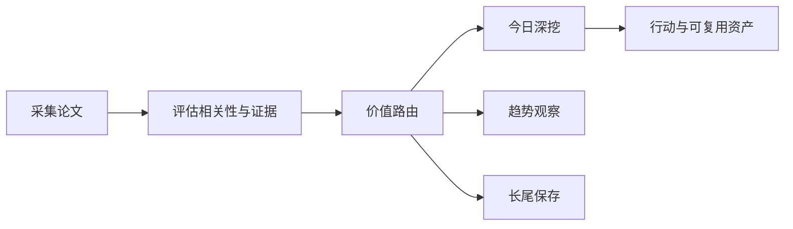

# 前沿理论驱动技术雷达

<h3 align="center">用可追溯证据判断：哪些前沿 AI 论文现在值得行动、哪些值得观察、哪些应当暂缓。</h3>

<p align="center">
  每日完成论文采集、价值路由、深度判断与趋势沉淀，区分即时价值、趋势价值、长尾价值与噪声。
</p>

<p align="center">
  <a href="README.md">English</a> ·
  <a href="https://radar.aiutil.com">在线雷达</a> ·
  <a href="https://radar.aiutil.com/daily.html">日报</a> ·
  <a href="https://radar.aiutil.com/about.html">研究方法</a>
</p>

<p align="center">
  <a href="https://github.com/aiutil/frontier-theory-radar/actions/workflows/ci.yml"></a>
  <a href="LICENSE"></a>
  
</p>


## 最新研究 · 2026-10-21

| 审阅论文 | 即时价值 | 趋势价值 | 长尾价值 | 暂时忽略 |
| ---: | ---: | ---: | ---: | ---: |
| 10 | 147 | 238 | 249 | 1356 |

**今日深挖：** [OpenVLHarness: Real World Visual Agentic Tool-Use with Multimodal Memory](daily/2026/2026-10-21.md) · 即时价值 · 重点学习

**核心判断：** 据摘要（arXiv 2610.26860），它先用受控实验否掉了最省事的那条路——'simply increasing the inference budget of the base model yields only modest gains'；然后把收益全部投在 harness 结构上：capability layer（统一异构后端并把输出转成模型可读观测）、persistent multimodal memory（把图像、结构化数据、网页引用作为可寻址 artifact 在整个 query 期间保留）、coding interface（在存好的数据上执行生成程序）。22 个 benchmark × 8 个开源与闭源 backbone 的 matched no-tool 对照给出平均 'improves average scores by 9.7-12.6 points over matched no-tool baselines'；成本侧最硬的一条是 'outperforms the base model, Codex, and Visual Sketchpad at maximum effort by 7.7-8.5 points while incurring at most 37% of their model-token cost'。三层结构今天就可以照着搭。

**建议动作：** 把 OpenVLHarness（[2610.26860](http://arxiv.org/abs/2610.26860)）列为今日即时试点主线，按 capability layer / persistent memory / coding interface 三层写 visual-tool-harness checklist；把 WeAct（[2610.26847](http://arxiv.org/abs/2610.26847)）与 Agima（[2610.26845](http://arxiv.org/abs/2610.26845)）列为即时试点第二梯队——分别产出 '_switch_capability 工具可行性评估' 与 'Agima omni 训练成本量级核验（仓库今日实测可达）'；把 AnyGoal（[2610.26844](http://arxiv.org/abs/2610.26844)）与 LatComm（[2610.26840](http://arxiv.org/abs/2610.26840)）纳入趋势雷达连续观察；把 FunCAD（[2610.26861](http://arxiv.org/abs/2610.26861)）、PhysRSI（[2610.26848](http://arxiv.org/abs/2610.26848)）、VAG（[2610.26856](http://arxiv.org/abs/2610.26856)）、CoopUQ（[2610.26852](http://arxiv.org/abs/2610.26852)）、Halcyon（[2610.26863](http://arxiv.org/abs/2610.26863)）存入长尾库并标注触发条件。


## 最近 7 期日报

| 日期 | 深挖论文 | 价值类型 | 判断 |
| --- | --- | --- | --- |
| [2026-10-21](daily/2026/2026-10-21.md) | OpenVLHarness: Real World Visual Agentic Tool-Use with Multimodal Memory | 即时价值 | 重点学习 |
| [2026-10-20](daily/2026/2026-10-20.md) | Self-Building Labs | 即时价值 | 重点学习 |
| [2026-10-19](daily/2026/2026-10-19.md) | MLExpert: Towards a Generalist Agentic Model for Autonomous Machine Learning Engineering | 即时价值 | 重点学习 |
| [2026-10-18](daily/2026/2026-10-18.md) | MLExpert: Towards a Generalist Agentic Model for Autonomous Machine Learning Engineering | 即时价值 | 轻量试点 |
| [2026-10-17](daily/2026/2026-10-17.md) | The World Won't Wait: Evaluating and Teaching Agents Under a Live Clock | 即时价值 | 轻量试点 |
| [2026-10-16](daily/2026/2026-10-16.md) | Co-Evolving Acting and Forecasting for Language Agents | 即时价值 | 轻量试点 |
| [2026-10-15](daily/2026/2026-10-15.md) | Hybrid Reasoning Agents | 即时价值 | 轻量试点 |

## 当前重点趋势

| 方向 | 阶段 | 关联论文 |
| --- | --- | ---: |
| [Agentic World Modeling](https://radar.aiutil.com/trend-detail.html?id=agentic-world-modeling) | 上升 | 611 |
| [Coding Agent](https://radar.aiutil.com/trend-detail.html?id=coding-agent) | 主流化 | 621 |
| [Context Engineering](https://radar.aiutil.com/trend-detail.html?id=context-engineering) | 上升 | 611 |

## 为什么做这个项目

论文聚合站通常优化“新”和“热”，本项目优化“判断”：哪些值得今天试验，哪些需要连续观察，哪些虽然不热但应该保留，哪些证据不足应明确暂缓。每个结论都保留来源，并写清当前最大不确定性。

## 研究工作流



- `papers/`：按日期保存来源快照和评分候选。
- `daily/`：保存每次研究运行的人类可读判断记录。
- `trends/`、`insights/`：沉淀跨日趋势与可复用发现。
- `docs/data/`：在线站点使用的结构化公开投影。
- `scripts/generate_readme.py`：从已提交证据生成双语 README 和活动图表。

## 证据边界

评分与结论属于研究判断，不等于独立复现。论文摘要、作者自述 Benchmark、开源实现与第三方复现是不同证据等级。代码缺失、摘要截断或 Benchmark 未核验时，会明确标注，不把推断包装成事实。

## 本地运行与验证

```bash
./run_daily.sh 2026-08-07
python3 -m pytest tests
python3 scripts/generate_readme.py
```

生产定时任务运行在 AIUtil 私有自动化环境中，凭据和私有运行记忆不进入本仓库。生成后的 Markdown、SVG、JSON 和来源链接均可通过 Git 历史审阅。

## 安全

请勿提交数据源凭据、API Token、私有论文集合或运营记忆。安全问题请通过 [GitHub Security Advisories](https://github.com/aiutil/frontier-theory-radar/security/advisories/new) 私下报告。

## 开源协议

Apache License 2.0，详见 [NOTICE](NOTICE)。
