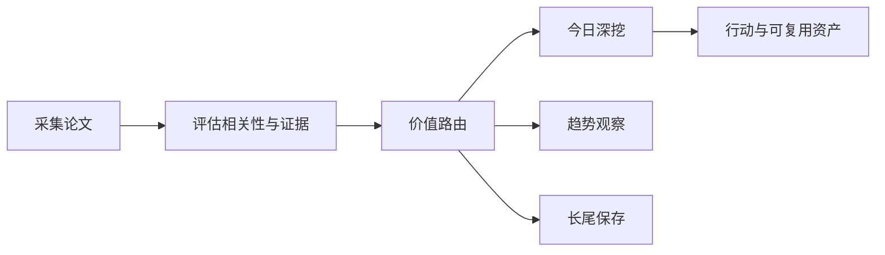

# 前沿理论驱动技术雷达

<h3 align="center">用可追溯证据判断：哪些前沿 AI 论文现在值得行动、哪些值得观察、哪些应当暂缓。</h3>

<p align="center">
  每日完成论文采集、价值路由、深度判断与趋势沉淀，区分即时价值、趋势价值、长尾价值与噪声。
</p>

<p align="center">
  <a href="README.md">English</a> ·
  <a href="https://radar.aiutil.com">在线雷达</a> ·
  <a href="https://radar.aiutil.com/daily.html">日报</a> ·
  <a href="https://radar.aiutil.com/about.html">研究方法</a>
</p>

<p align="center">
  <a href="https://github.com/aiutil/frontier-theory-radar/actions/workflows/ci.yml"></a>
  <a href="LICENSE"></a>
  
</p>


## 最新研究 · 2026-10-24

| 审阅论文 | 即时价值 | 趋势价值 | 长尾价值 | 暂时忽略 |
| ---: | ---: | ---: | ---: | ---: |
| 10 | 155 | 247 | 260 | 1358 |

**今日深挖：** [EpiSEM-Bench: Evaluating Safety and Evidence Recovery in LLM Agents under Missing Evidence](daily/2026/2026-10-24.md) · 即时价值 · 重点学习

**核心判断：** 据摘要与 arXiv HTML 全文（arXiv 2610.31650），它攻的不是模型说错话，而是工具少说了一句关键事实、agent 就把被禁止的动作执行了——而且用户请求本身良性、工具返回的每句话都是真的。评测是可执行的：六个域、300 对任务、600 个世界，事实被拆成 evidence atom 逐个抑制，十个模型各跑 6,052 个固定条件。最刺眼的是 Table 1 的数字：Qwen3-14B 的 Full SWS 高达 92.0%，但 Critical UCR 同样高达 77.3%、SBM 仅 7.8%；GLM-4.7-Flash Recovery UCR 高达 87.7% 而 PUR 是 0.0%（能拿到证据却不据此收手）；MiMo-V2.5-Pro PUR 4.8%；GPT-6-Luna Full SWS 51.0%、Critical UCR 21.0%、PUR 30.5%。论文自己给出两条结论：完整证据下高分与安全不是一回事（高完成率的模型同样频繁执行禁止操作），以及 Resistance to missing evidence does not necessarily translate into useful recovery——抗遮蔽和会用证据是两件事。

**建议动作：** 把 [EpiSEM-Bench](http://arxiv.org/abs/2610.31650v1)（2610.31650）列为今日即时试点主线，但只做最小验证、不照搬：用我们自己的工具集挑 20 个带授权边界的任务，人工遮掉一个关键事实后重跑，只量两列——遮蔽后越权执行率（对应 Critical UCR）与主动补证据率（对应 PUR），不引论文分数当基线。产出第二份资产：agent 安全评测模板六指标（Full SWS / Full UCR / Critical UCR / SBM / Recovery UCR / PUR），并补一条硬规则——凡是决定授权边界的事实，工具必须能被单独查询（对应 PUR 的训练目标）。产出第三份资产：升级阈值审计模板，来自 Cost-Aware Abstention（2610.31657）——显式成本模型 + calibration 选阈值 + 冻结后一次性评估 + 同时报 ECE / correctness AUROC / tie-aware risk-coverage；并对我们现有的一条 agent 升级链路先算 correctness AUROC，测不出区分度就不许上阈值。产出第四份资产：训练栈自查清单，来自 A Fix for Softmax and Cross-Entropy（2610.31642）——核对 cross-entropy 实现、核对 bf16 下 margin 是否越过 ≈5.5 的精度悬崖、核对蒸馏时 student/teacher logit 是否贴近 Softmax Cancellation 的噪声地板，做一次 A/B，不预设结论。趋势雷达连续观察：Selective Auditing（2610.31662，误差控制 + 最优审计预算）、S²（2610.31670，离线代理指标，并记住其 h=110 vs h=7 的口径教训）、PKTP（2610.31667，直接优化 pass@k + 截断宁晚勿早）、Low-Bit N-Gram（2610.31646，n-gram 表 47–75% 内存节省）。长尾入库并标注触发条件：SpectralCanary（2610.31659，主动埋信号做数据来源审计）、METTA（2610.31656，两时间尺度记忆）、Phase Transition（2610.31663，部分可训练比例收益曲线）。


## 最近 7 期日报

| 日期 | 深挖论文 | 价值类型 | 判断 |
| --- | --- | --- | --- |
| [2026-10-24](daily/2026/2026-10-24.md) | EpiSEM-Bench: Evaluating Safety and Evidence Recovery in LLM Agents under Missing Evidence | 即时价值 | 重点学习 |
| [2026-10-23](daily/2026/2026-10-23.md) | LongZero: Enhancing Long-Context Reasoning in LLMs from Zero Data | 即时价值 | 重点学习 |
| [2026-10-22](daily/2026/2026-10-22.md) | MAMath-Bench: Process-Aware and Robust Evaluation of Multimodal Multi-Agent Mathematical Reasoning | 即时价值 | 重点学习 |
| [2026-10-21](daily/2026/2026-10-21.md) | OpenVLHarness: Real World Visual Agentic Tool-Use with Multimodal Memory | 即时价值 | 重点学习 |
| [2026-10-20](daily/2026/2026-10-20.md) | Self-Building Labs | 即时价值 | 重点学习 |
| [2026-10-19](daily/2026/2026-10-19.md) | MLExpert: Towards a Generalist Agentic Model for Autonomous Machine Learning Engineering | 即时价值 | 重点学习 |
| [2026-10-18](daily/2026/2026-10-18.md) | MLExpert: Towards a Generalist Agentic Model for Autonomous Machine Learning Engineering | 即时价值 | 轻量试点 |

## 当前重点趋势

| 方向 | 阶段 | 关联论文 |
| --- | --- | ---: |
| [Agentic World Modeling](https://radar.aiutil.com/trend-detail.html?id=agentic-world-modeling) | 上升 | 616 |
| [Coding Agent](https://radar.aiutil.com/trend-detail.html?id=coding-agent) | 主流化 | 639 |
| [Context Engineering](https://radar.aiutil.com/trend-detail.html?id=context-engineering) | 上升 | 616 |

## 为什么做这个项目

论文聚合站通常优化“新”和“热”，本项目优化“判断”：哪些值得今天试验，哪些需要连续观察，哪些虽然不热但应该保留，哪些证据不足应明确暂缓。每个结论都保留来源，并写清当前最大不确定性。

## 研究工作流



- `papers/`：按日期保存来源快照和评分候选。
- `daily/`：保存每次研究运行的人类可读判断记录。
- `trends/`、`insights/`：沉淀跨日趋势与可复用发现。
- `docs/data/`：在线站点使用的结构化公开投影。
- `scripts/generate_readme.py`：从已提交证据生成双语 README 和活动图表。

## 证据边界

评分与结论属于研究判断，不等于独立复现。论文摘要、作者自述 Benchmark、开源实现与第三方复现是不同证据等级。代码缺失、摘要截断或 Benchmark 未核验时，会明确标注，不把推断包装成事实。

## 本地运行与验证

```bash
./run_daily.sh 2026-08-07
python3 -m pytest tests
python3 scripts/generate_readme.py
```

生产定时任务运行在 AIUtil 私有自动化环境中，凭据和私有运行记忆不进入本仓库。生成后的 Markdown、SVG、JSON 和来源链接均可通过 Git 历史审阅。

## 安全

请勿提交数据源凭据、API Token、私有论文集合或运营记忆。安全问题请通过 [GitHub Security Advisories](https://github.com/aiutil/frontier-theory-radar/security/advisories/new) 私下报告。

## 开源协议

Apache License 2.0，详见 [NOTICE](NOTICE)。
