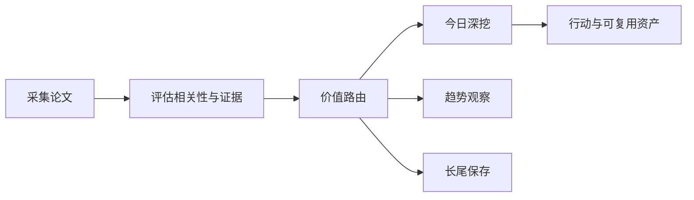

# 前沿理论驱动技术雷达

<h3 align="center">用可追溯证据判断：哪些前沿 AI 论文现在值得行动、哪些值得观察、哪些应当暂缓。</h3>

<p align="center">
  每日完成论文采集、价值路由、深度判断与趋势沉淀，区分即时价值、趋势价值、长尾价值与噪声。
</p>

<p align="center">
  <a href="README.md">English</a> ·
  <a href="https://radar.aiutil.com">在线雷达</a> ·
  <a href="https://radar.aiutil.com/daily.html">日报</a> ·
  <a href="https://radar.aiutil.com/about.html">研究方法</a>
</p>

<p align="center">
  <a href="https://github.com/aiutil/frontier-theory-radar/actions/workflows/ci.yml"></a>
  <a href="LICENSE"></a>
  
</p>


## 最新研究 · 2026-10-16

| 审阅论文 | 即时价值 | 趋势价值 | 长尾价值 | 暂时忽略 |
| ---: | ---: | ---: | ---: | ---: |
| 10 | 138 | 226 | 231 | 1355 |

**今日深挖：** [Co-Evolving Acting and Forecasting for Language Agents](daily/2026/2026-10-16.md) · 即时价值 · 轻量试点

**核心判断：** 据摘要（arXiv [2610.20597](http://arxiv.org/abs/2610.20597v1)），论文把 language agent RL 的'长 horizon rollout cost 高 / 中间步骤监督浪费 / value target 与 observation target 都难构造'拉到'co-evolving acting and forecasting：用一个 forecast head 提供 intermediate supervision / 提升 sample efficiency'。是 ai-agent × llm-evaluation × inference-serving 的 'agentic RL co-evolving supervision' 即时价值资产——把 'language agent training' 从 'one terminal scalar reward' 或 'hand-crafted value / observation target' 三态拉到 'co-evolving acting and forecasting'，与昨日 2026-10-15 的 Two Clocks 在 'RLVR rollout sample efficiency'、DoubtLess 在 'reasoning cost' 层面同源；今日新观点：'co-evolving acting-and-forecasting supervision' 是 aiutil 长期关注的 ai-agent × llm-evaluation 主线在 'agentic RL intermediate supervision' 的具体范式响应。

**建议动作：** 把 [2610.20597](http://arxiv.org/abs/2610.20597v1) Co-Evolving Acting and Forecasting 'co-evolving acting-and-forecasting agentic RL' 列为即时试点方向，写 'co-evolving acting-and-forecasting agentic RL' checklist 草稿；把 [2610.20588](http://arxiv.org/abs/2610.20588v1) Your Transformer Is Secretly Elastic 'retraining-free elastic transformer on-the-fly compute-budget adaptation' 列为即时路线资产，写 'elastic transformer compute budget' checklist 草稿；把 [2610.20582](http://arxiv.org/abs/2610.20582v1) Latent Compaction 'TTT-based KV cache compaction' 列为即时路线资产，写 'TTT-based KV cache compaction' checklist 草稿；为 [2610.20586](http://arxiv.org/abs/2610.20586v1) Continuum Attention 'continuous-curve attention operator'、[2610.20607](http://arxiv.org/abs/2610.20607v1) HiRe-MoMa 'hierarchical-residual MoMa real-world fine-tuning'、[2610.20587](http://arxiv.org/abs/2610.20587v1) Price of Anarchy 'agentic market FPA price-of-anarchy theory' 设置 7 天观察周期；为 [2610.20584](http://arxiv.org/abs/2610.20584v1) Player-1 'synthetic-experience game-agent training' 维持长尾卡片。⚠️ 今日抓取列表与昨日 2026-10-15 的 2610.1885x-1887x 区间完全不同，新一批 arXiv 提交（2610.20578-2610.20607）进入 submittedDate desc 前列，价值路由发生根本性变化（不是 '维持 / 微调'）——昨日的 Hybrid Reasoning Agents / Tev / DoubtLess / Two Clocks / ChunkAct / AesCode / VLA Pretraining Quality / Cepheid / Exact Topological Compliance / Data Free Diffusion 不再出现，今日改为 Co-Evolving Acting and Forecasting / Your Transformer Is Secretly Elastic / Latent Compaction 即时试点 + Continuum Attention / HiRe-MoMa / Price of Anarchy 趋势卡片 + Player-1 长尾 + Humanoid Weights Diffusion / Hodge-Laplacian MoE / SquashFS HPC 暂忽略；持续观察所有 10 篇是否开源 code / benchmark / project page；尤其关注 Co-Evolving 是否公开 forecast head 训练协议、Elastic Transformer 是否公开 on-the-fly compute-budget 适配 API、Latent Compaction 是否公开 TTT cache training harness。⚠️ 证据标记：所有 10 篇论文均未在摘要里显式披露 code / benchmark / project URL（仅 PDF / arXiv），按规则统一标'暂无'，证据不足项需打开 PDF 核验；链接或证据缺失时明确写'待核验/暂无'，不补写不存在的事实。


## 最近 7 期日报

| 日期 | 深挖论文 | 价值类型 | 判断 |
| --- | --- | --- | --- |
| [2026-10-16](daily/2026/2026-10-16.md) | Co-Evolving Acting and Forecasting for Language Agents | 即时价值 | 轻量试点 |
| [2026-10-15](daily/2026/2026-10-15.md) | Hybrid Reasoning Agents | 即时价值 | 轻量试点 |
| [2026-10-14](daily/2026/2026-10-14.md) | RSI-Anything: Unlocking Recursive Self-Improvement with World Models | 即时价值 | 轻量试点 |
| [2026-10-13](daily/2026/2026-10-13.md) | RSI-Anything: Unlocking Recursive Self-Improvement with World Models | 即时价值 | 轻量试点 |
| [2026-10-12](daily/2026/2026-10-12.md) | From Reactive Containment to Proactive Assurance: Lessons from OpenAI, Anthropic, and Google Agent Security Incidents | 暂时忽略 | 暂时忽略 |
| [2026-10-11](daily/2026/2026-10-11.md) | From Reactive Containment to Proactive Assurance: Lessons from OpenAI, Anthropic, and Google Agent Security Incidents | 暂时忽略 | 暂时忽略 |
| [2026-10-10](daily/2026/2026-10-10.md) | CSF: Contextual Safety Filtering for Motion Generators | 即时价值 | 轻量试点 |

## 当前重点趋势

| 方向 | 阶段 | 关联论文 |
| --- | --- | ---: |
| [Agentic World Modeling](https://radar.aiutil.com/trend-detail.html?id=agentic-world-modeling) | 上升 | 604 |
| [Coding Agent](https://radar.aiutil.com/trend-detail.html?id=coding-agent) | 主流化 | 595 |
| [Context Engineering](https://radar.aiutil.com/trend-detail.html?id=context-engineering) | 上升 | 604 |

## 为什么做这个项目

论文聚合站通常优化“新”和“热”，本项目优化“判断”：哪些值得今天试验，哪些需要连续观察，哪些虽然不热但应该保留，哪些证据不足应明确暂缓。每个结论都保留来源，并写清当前最大不确定性。

## 研究工作流



- `papers/`：按日期保存来源快照和评分候选。
- `daily/`：保存每次研究运行的人类可读判断记录。
- `trends/`、`insights/`：沉淀跨日趋势与可复用发现。
- `docs/data/`：在线站点使用的结构化公开投影。
- `scripts/generate_readme.py`：从已提交证据生成双语 README 和活动图表。

## 证据边界

评分与结论属于研究判断，不等于独立复现。论文摘要、作者自述 Benchmark、开源实现与第三方复现是不同证据等级。代码缺失、摘要截断或 Benchmark 未核验时，会明确标注，不把推断包装成事实。

## 本地运行与验证

```bash
./run_daily.sh 2026-08-07
python3 -m pytest tests
python3 scripts/generate_readme.py
```

生产定时任务运行在 AIUtil 私有自动化环境中，凭据和私有运行记忆不进入本仓库。生成后的 Markdown、SVG、JSON 和来源链接均可通过 Git 历史审阅。

## 安全

请勿提交数据源凭据、API Token、私有论文集合或运营记忆。安全问题请通过 [GitHub Security Advisories](https://github.com/aiutil/frontier-theory-radar/security/advisories/new) 私下报告。

## 开源协议

Apache License 2.0，详见 [NOTICE](NOTICE)。
