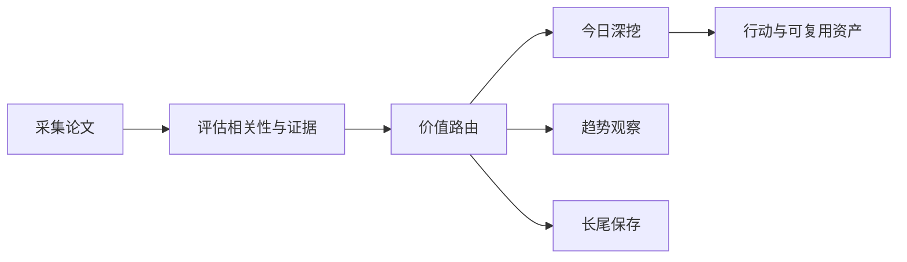

# 前沿理论驱动技术雷达

<h3 align="center">用可追溯证据判断：哪些前沿 AI 论文现在值得行动、哪些值得观察、哪些应当暂缓。</h3>

<p align="center">
  每日完成论文采集、价值路由、深度判断与趋势沉淀，区分即时价值、趋势价值、长尾价值与噪声。
</p>

<p align="center">
  <a href="README.md">English</a> ·
  <a href="https://radar.aiutil.com">在线雷达</a> ·
  <a href="https://radar.aiutil.com/daily.html">日报</a> ·
  <a href="https://radar.aiutil.com/about.html">研究方法</a>
</p>

<p align="center">
  <a href="https://github.com/aiutil/frontier-theory-radar/actions/workflows/ci.yml"></a>
  <a href="LICENSE"></a>
  
</p>


## 最新研究 · 2026-11-04

| 审阅论文 | 即时价值 | 趋势价值 | 长尾价值 | 暂时忽略 |
| ---: | ---: | ---: | ---: | ---: |
| 10 | 171 | 270 | 276 | 1366 |

**今日深挖：** [WebHarbor: Docking Real Websites for Evolving GUI Agent Environments](daily/2026/2026-11-04.md) · 即时价值 · 重点学习

**核心判断：** 我用 GitHub API 逐条核实了它的工件，**不是转述摘要**：仓库 `aiming-lab/WebHarbor` 实测存在（pushed 2026-11-03，stars=42，forks=42），我用 API 列出 `sites/` 目录，**实测恰好 153 个站点子目录，与论文声称的数量完全一致**——这是今天唯一被独立复算过的工件数量。数据集（`ChilleD/WebHarbor`）与模型（`ChilleD/WebHarbor-4B`）在 hf-mirror 镜像上实测均存在且 2026-11-03 刚更新。README 与项目页给出论文摘要里没有的**对照基线**：同为 4B 的 OpenWebRL-4B 是基线，WebHarbor-4B 在 live-web 平均分 **+5.2（75.8 vs 70.6）**、比共同 SFT checkpoint 高 **+22.2**，且 **6/6 成对排名保持、Spearman 1.00**。

**建议动作：** 今天做四件事，按依赖顺序：(1) **零依赖、30 分钟——先立规则，不等任何下载。** 把两条硬约束写进我们的评测规范：① **WebHarbor 的绝对分比真实站点高 4.4–18.8 分，只能用于相对排序，不能当真实成绩汇报**（依据：项目页实测的 6/6 排名一致 + Spearman 1.00 + Pearson 0.80）；② **第三方论文代码安装前必须先核对 PyPI 项目名与作者**——今天实测 `pip install dna` 会静默装上一个无关的 PyPI 模板包（作者 HaveTwoBrush），而 D&A 的真实项目名 `reward-vlm` 在 PyPI 上 404，**pip 不会报错**。(2) **1–2 小时——量化我们自己的环境漂移。** 选一个我们已有稳定结论的 agent 评测任务，把它在「真实上游」和「固化镜像」两种环境各跑一次（先只固 2–3 个最常用的内部系统，不要一次铺开），比对逐条分数与任务级排序。**产出一个数字：我们自己的离线评测与真实环境差多少分、排序是否保持**——这是把 WebHarbor 的方法内化，而不是照抄它。(3) **2 小时——把 D&A 的「先描述后评估」模式抄成我们的 rubric 模板（不需要 GPU、不需要机器人）。** 拿一条现有的 agent 轨迹评测（或一次代码评审）做试点：第一步让模型在**不给出任务目标**的前提下客观描述发生了什么，第二步再对照一份显式判据打分，对比今天单步打分的分数差异。**这一步会直接暴露我们现有评审流程里有多少确认偏置。** 注意 D&A 的实际调用需要 Gemini/GPT/Claude/OpenRouter 的 API key（其本地 Qwen-VL 路径官方标注 in development、not fully validated），**先做小样本、核算 token 成本再放量**。(4) **今天不做的三件事（明确记下来，避免被带跑）：** ① 不下载 WebHarbor 的完整 20 GB 镜像（hub.docker.com 今日全程超时，体积与能否 build 尚未核实，且许可证状态待核验——**先解决许可问题再谈下载**）；② 不改我们的优化器配置（Muon-AdamW 反转那篇没有代码、需要多卡复现、外推性未定，**观察 7–30 天**）；③ 不投入 FADE 与斑马谜题（一个无代码、一个载体太玩具）。


## 最近 7 期日报

| 日期 | 深挖论文 | 价值类型 | 判断 |
| --- | --- | --- | --- |
| [2026-11-04](daily/2026/2026-11-04.md) | WebHarbor: Docking Real Websites for Evolving GUI Agent Environments | 即时价值 | 重点学习 |
| [2026-11-03](daily/2026/2026-11-03.md) | Flide: Accelerating Decision Inference with Exact State Forking | 即时价值 | 重点学习 |
| [2026-11-02](daily/2026/2026-11-02.md) | Elucidating the Design Space of LM Data Attribution | 即时价值 | 重点学习 |
| [2026-11-01](daily/2026/2026-11-01.md) | Elucidating the Design Space of LM Data Attribution | 即时价值 | 重点学习 |
| [2026-10-30](daily/2026/2026-10-30.md) | Heads of Security: Learned Attention Gates Improve Prompt Injection Robustness | 即时价值 | 重点学习 |
| [2026-10-28](daily/2026/2026-10-28.md) | I-HITL: Inalienable Human-in-the-Loop | 即时价值 | 重点学习 |
| [2026-10-27](daily/2026/2026-10-27.md) | Measure Before You Train: Typed Decision Models vs. a Classical Baseline vs. a Generative LLM for Routing a Personal Multilingual Inbox | 即时价值 | 重点学习 |

## 当前重点趋势

| 方向 | 阶段 | 关联论文 |
| --- | --- | ---: |
| [Agentic World Modeling](https://radar.aiutil.com/trend-detail.html?id=agentic-world-modeling) | 上升 | 627 |
| [Coding Agent](https://radar.aiutil.com/trend-detail.html?id=coding-agent) | 主流化 | 673 |
| [Context Engineering](https://radar.aiutil.com/trend-detail.html?id=context-engineering) | 上升 | 627 |

## 为什么做这个项目

论文聚合站通常优化“新”和“热”，本项目优化“判断”：哪些值得今天试验，哪些需要连续观察，哪些虽然不热但应该保留，哪些证据不足应明确暂缓。每个结论都保留来源，并写清当前最大不确定性。

## 研究工作流



- `papers/`：按日期保存来源快照和评分候选。
- `daily/`：保存每次研究运行的人类可读判断记录。
- `trends/`、`insights/`：沉淀跨日趋势与可复用发现。
- `docs/data/`：在线站点使用的结构化公开投影。
- `scripts/generate_readme.py`：从已提交证据生成双语 README 和活动图表。

## 证据边界

评分与结论属于研究判断，不等于独立复现。论文摘要、作者自述 Benchmark、开源实现与第三方复现是不同证据等级。代码缺失、摘要截断或 Benchmark 未核验时，会明确标注，不把推断包装成事实。

## 本地运行与验证

```bash
./run_daily.sh 2026-08-07
python3 -m pytest tests
python3 scripts/generate_readme.py
```

生产定时任务运行在 AIUtil 私有自动化环境中，凭据和私有运行记忆不进入本仓库。生成后的 Markdown、SVG、JSON 和来源链接均可通过 Git 历史审阅。

## 安全

请勿提交数据源凭据、API Token、私有论文集合或运营记忆。安全问题请通过 [GitHub Security Advisories](https://github.com/aiutil/frontier-theory-radar/security/advisories/new) 私下报告。

## 开源协议

Apache License 2.0，详见 [NOTICE](NOTICE)。
