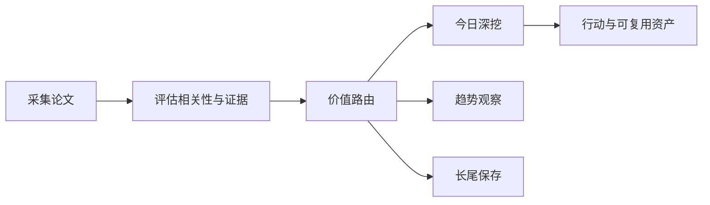

# 前沿理论驱动技术雷达

<h3 align="center">用可追溯证据判断：哪些前沿 AI 论文现在值得行动、哪些值得观察、哪些应当暂缓。</h3>

<p align="center">
  每日完成论文采集、价值路由、深度判断与趋势沉淀，区分即时价值、趋势价值、长尾价值与噪声。
</p>

<p align="center">
  <a href="README.md">English</a> ·
  <a href="https://radar.aiutil.com">在线雷达</a> ·
  <a href="https://radar.aiutil.com/daily.html">日报</a> ·
  <a href="https://radar.aiutil.com/about.html">研究方法</a>
</p>

<p align="center">
  <a href="https://github.com/aiutil/frontier-theory-radar/actions/workflows/ci.yml"></a>
  <a href="LICENSE"></a>
  
</p>


## 最新研究 · 2026-10-27

| 审阅论文 | 即时价值 | 趋势价值 | 长尾价值 | 暂时忽略 |
| ---: | ---: | ---: | ---: | ---: |
| 10 | 157 | 253 | 261 | 1359 |

**今日深挖：** [Measure Before You Train: Typed Decision Models vs. a Classical Baseline vs. a Generative LLM for Routing a Personal Multilingual Inbox](daily/2026/2026-10-27.md) · 即时价值 · 重点学习

**核心判断：** 据 arXiv 2610.32955 摘要与 LaTeXML HTML 全文（今日回原文逐字复核）以及配套仓库 gitlab.com/federicolucca/foyer-measure 的本地实跑：这篇指出个人邮件 agent 的错误率几乎从未被测量，因为数据库里的标签是系统自己写的（the labels in the database were written by the system itself），然后给出一套在训练前就产出 ground truth 的协议：分层抽样、冻结模型实际看到的快照（sender/subject/body 截断 1,500 字符/date/channel）、按线程而非邮件 id 切分、密钥脱敏、在 agent 自己的 review 回路里由人做标签、并在打开标签前预注册假设。作者用 9 个系统在同口径下比较（生产关键词规则、TF-IDF+LogReg、Tev1 0.8B/4B、Nimble 9B 本地、托管 Nimble v4-max、Qwen2.5-7B、Gemma 4 26B-A4B/31B）。四条结论（**均为作者自述，本机无法复现数值**，因作者明示邮件与标签不公开）：(1) 生产规则在消息类型上只有 28%，而多数类是 58%——仪表盘上最显眼的那个字段其实不携带信息；(2) 约 200 条标注下，逻辑回归在每个字段上准确率最高（type 0.79 / urgency 0.74 / needs-reply 0.83 / is-noise 0.90），延迟低三个数量级，但从不预测两个最稀有类，与 Gemma 4 在 type 上统计打平，少样本提示补不上差距；(3) 发件人关系（客户/供应商/服务）能从同一联系人的其他邮件里以 98.6% 准确率恢复（仅对 63% 已见过的发件地址有效，整体含多数类回退为 85.7%），任何模型都无法从单封邮件推断——**它属于 contact graph，不属于 prompt**；(4) 准确率不是产品指标：合成到动作后，字段上最准的系统恰恰最常忽略需要处理的邮件（18% vs 最好 LLM 的 4%），因为它精确而保守、LLM 反而过度动作；对噪声概率做成本化阈值选择后该比例减半（v3 从 28/120 到 13/120，v2 从 12/68 到 7/68，Platt scaling 后 4/68），代价是处理两三倍多的噪声。★ **今日证据等级实质升级（这是本篇今日最重要的变化）：** 配套仓库（论文 abs 页未给链接，是今日新发现的第三方实现）今日拉下来本地实跑——`python3 -m py_compile` 四个脚本全部通过；kappa.py 端到端跑通，用自造 60 条注入约 10% 分歧的标注实跑，五个字段全部正确产出 raw agreement / Cohen's κ / 2000 次 bootstrap 的 95% CI / 混淆矩阵 / 分歧明细（urgenza accordo=0.983 kappa=0.975 [IC95% 0.922, 1.000]；e_rumore accordo=0.950 kappa=0.900 [IC95% 0.768, 1.000]）；bench_email.py 的 TF-IDF+LogReg 基线路径也跑通——带类别信号的 400 条合成集上 acc=1.000 / macroF1=0.857，无信号的 240 条随机集上 acc=0.167 / macroF1=0.138，两次都符合预期，说明 harness 的学习路径和退化路径都真实工作。

**建议动作：** 抄 Foyer 七步测量协议并在我们自己的收件箱/工单流上跑第一轮（抽 120–250 条、冻结快照、按线程切分、人工标注），今天只数三个数——多数类基线、生产规则基线、字段准确率——然后只盯「需要动作却被忽略」的比例；同时把它的 kappa.py（纯标准库、含 bootstrap CI）抄进评测工具链。附带三件不依赖任何论文数字的工程动作：给训练-推理一致性加 RoPE/激活/归一化位置误差断言；把「指令动作 + 实测状态」双写进 tool-call 日志；用 RobustRLlib 的语义/物理/时序扰动维度建我们自己的 agent shift 清单。


## 最近 7 期日报

| 日期 | 深挖论文 | 价值类型 | 判断 |
| --- | --- | --- | --- |
| [2026-10-27](daily/2026/2026-10-27.md) | Measure Before You Train: Typed Decision Models vs. a Classical Baseline vs. a Generative LLM for Routing a Personal Multilingual Inbox | 即时价值 | 重点学习 |
| [2026-10-26](daily/2026/2026-10-26.md) | EpiSEM-Bench: Evaluating Safety and Evidence Recovery in LLM Agents under Missing Evidence | 即时价值 | 重点学习 |
| [2026-10-25](daily/2026/2026-10-25.md) | EpiSEM-Bench: Evaluating Safety and Evidence Recovery in LLM Agents under Missing Evidence | 即时价值 | 重点学习 |
| [2026-10-24](daily/2026/2026-10-24.md) | EpiSEM-Bench: Evaluating Safety and Evidence Recovery in LLM Agents under Missing Evidence | 即时价值 | 重点学习 |
| [2026-10-23](daily/2026/2026-10-23.md) | LongZero: Enhancing Long-Context Reasoning in LLMs from Zero Data | 即时价值 | 重点学习 |
| [2026-10-22](daily/2026/2026-10-22.md) | MAMath-Bench: Process-Aware and Robust Evaluation of Multimodal Multi-Agent Mathematical Reasoning | 即时价值 | 重点学习 |
| [2026-10-21](daily/2026/2026-10-21.md) | OpenVLHarness: Real World Visual Agentic Tool-Use with Multimodal Memory | 即时价值 | 重点学习 |

## 当前重点趋势

| 方向 | 阶段 | 关联论文 |
| --- | --- | ---: |
| [Agentic World Modeling](https://radar.aiutil.com/trend-detail.html?id=agentic-world-modeling) | 上升 | 617 |
| [Coding Agent](https://radar.aiutil.com/trend-detail.html?id=coding-agent) | 主流化 | 643 |
| [Context Engineering](https://radar.aiutil.com/trend-detail.html?id=context-engineering) | 上升 | 617 |

## 为什么做这个项目

论文聚合站通常优化“新”和“热”，本项目优化“判断”：哪些值得今天试验，哪些需要连续观察，哪些虽然不热但应该保留，哪些证据不足应明确暂缓。每个结论都保留来源，并写清当前最大不确定性。

## 研究工作流



- `papers/`：按日期保存来源快照和评分候选。
- `daily/`：保存每次研究运行的人类可读判断记录。
- `trends/`、`insights/`：沉淀跨日趋势与可复用发现。
- `docs/data/`：在线站点使用的结构化公开投影。
- `scripts/generate_readme.py`：从已提交证据生成双语 README 和活动图表。

## 证据边界

评分与结论属于研究判断，不等于独立复现。论文摘要、作者自述 Benchmark、开源实现与第三方复现是不同证据等级。代码缺失、摘要截断或 Benchmark 未核验时，会明确标注，不把推断包装成事实。

## 本地运行与验证

```bash
./run_daily.sh 2026-08-07
python3 -m pytest tests
python3 scripts/generate_readme.py
```

生产定时任务运行在 AIUtil 私有自动化环境中，凭据和私有运行记忆不进入本仓库。生成后的 Markdown、SVG、JSON 和来源链接均可通过 Git 历史审阅。

## 安全

请勿提交数据源凭据、API Token、私有论文集合或运营记忆。安全问题请通过 [GitHub Security Advisories](https://github.com/aiutil/frontier-theory-radar/security/advisories/new) 私下报告。

## 开源协议

Apache License 2.0，详见 [NOTICE](NOTICE)。
