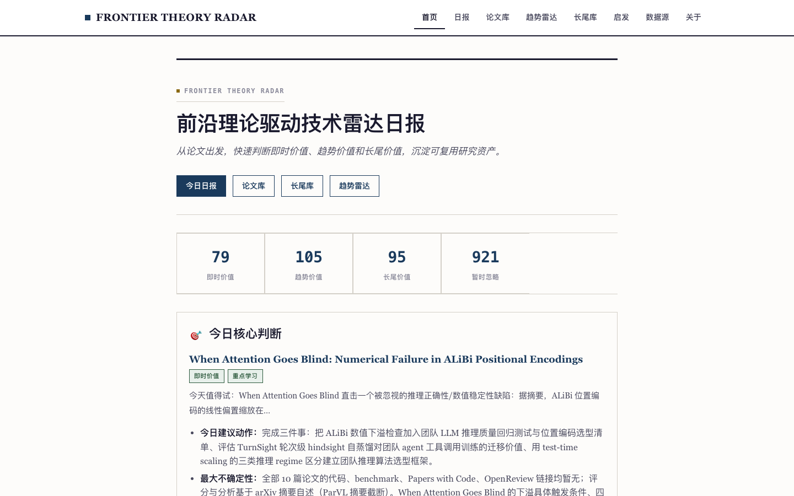
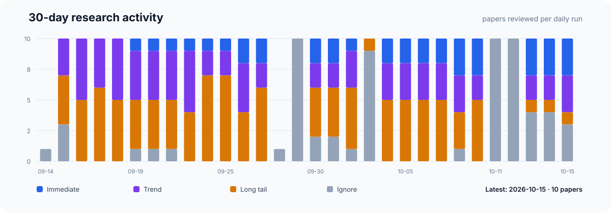
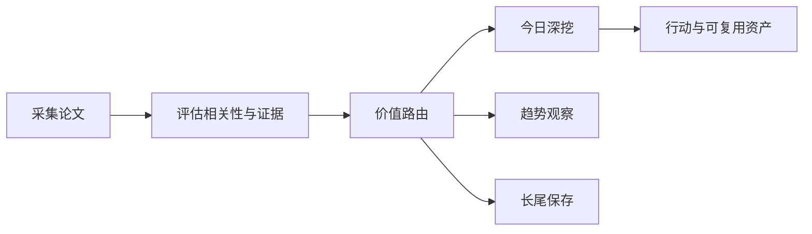

# 前沿理论驱动技术雷达

<h3 align="center">用可追溯证据判断：哪些前沿 AI 论文现在值得行动、哪些值得观察、哪些应当暂缓。</h3>

<p align="center">
  每日完成论文采集、价值路由、深度判断与趋势沉淀，区分即时价值、趋势价值、长尾价值与噪声。
</p>

<p align="center">
  <a href="README.md">English</a> ·
  <a href="https://radar.aiutil.com">在线雷达</a> ·
  <a href="https://radar.aiutil.com/daily.html">日报</a> ·
  <a href="https://radar.aiutil.com/about.html">研究方法</a>
</p>

<p align="center">
  <a href="https://github.com/aiutil/frontier-theory-radar/actions/workflows/ci.yml"></a>
  <a href="LICENSE"></a>
  
</p>



## 最新研究 · 2026-10-23

| 审阅论文 | 即时价值 | 趋势价值 | 长尾价值 | 暂时忽略 |
| ---: | ---: | ---: | ---: | ---: |
| 10 | 152 | 243 | 257 | 1358 |

**今日深挖：** [LongZero: Enhancing Long-Context Reasoning in LLMs from Zero Data](daily/2026/2026-10-23.md) · 即时价值 · 重点学习

**核心判断：** 据摘要（arXiv 2610.30132），它攻击的是一个会随时间自我收紧的墙——自蒸馏合成数据 'depend on external corpora or stronger teacher models, which become harder to obtain as the trained models get stronger'：模型越强，能拿来当教师的数据源越少，这是结构性天花板而非工程麻烦。解法是反直觉的顺序倒置：不先铺长文档再出题，而是 'first has the model synthesize the question and answer with its supporting evidence in a compact structured form, and only then separately expands the evidence into a long multi-document context'，即短结构化生成在前、长上下文膨胀在后，把可控性与长度解耦。训练侧用自造的多跳推理任务混多轮检索任务，以 GRPO 训练。

**建议动作：** 把 [LongZero](http://arxiv.org/abs/2610.30132v1)（2610.30132）列为今日即时试点主线，但只做最小验证、不照搬：用我们自己的模型跑一遍'短结构化生成 → 长上下文膨胀'，只量一列——膨胀后证据链的可验证率（这是 GRPO 可信的前提，也是摘要未交代的风险点），产出对照表（模型 × 膨胀倍率 × 可验证率）。产出第二份资产：评测模板三条硬规则（开发窗口反馈 / 封存期一次性冻结 / 强制计入推理与调用成本），来自 Quant-Arena（2610.30113），落点是检查我们现有评测是否在反馈窗口上反复看过封存期数据、以及是否对推理预算差异巨大的候选方案做了成本归一。产出第三份资产：agent 评测模板新增第二根轴——出题者区分度（出题者与最强解题者是否同一人），来自 Environment Duels（2610.30116）的 'the strongest solvers are not the strongest authors'，适用于所有用 LLM 自动生成评测题/环境的场景。第四份：抄 A-greement（2610.30114）的领域 harness 三件套模板（概念型知识库 / 模块化实现骨架 / 形式化验证框架），并记下它的副产品论证——形式化可能主要价值在暴露存量漏洞而非证明新方案。趋势雷达连续观察：LoopRec（2610.30128，逐项自适应算力分配）、PhysiCalWorld（2610.30125，一次性探索压成可复用条件向量、零物理标注训练）。长尾入库并标注触发条件：CNN locality/weight sharing（2610.30118）、ℓ∞ Contractions（2610.30122）、再生过程 Bernstein（2610.30119，数据管线具再生结构时触发）。NPMLE 高斯混合（2610.30109）保留最小索引。



## 最近 7 期日报

| 日期 | 深挖论文 | 价值类型 | 判断 |
| --- | --- | --- | --- |
| [2026-10-23](daily/2026/2026-10-23.md) | LongZero: Enhancing Long-Context Reasoning in LLMs from Zero Data | 即时价值 | 重点学习 |
| [2026-10-22](daily/2026/2026-10-22.md) | MAMath-Bench: Process-Aware and Robust Evaluation of Multimodal Multi-Agent Mathematical Reasoning | 即时价值 | 重点学习 |
| [2026-10-21](daily/2026/2026-10-21.md) | OpenVLHarness: Real World Visual Agentic Tool-Use with Multimodal Memory | 即时价值 | 重点学习 |
| [2026-10-20](daily/2026/2026-10-20.md) | Self-Building Labs | 即时价值 | 重点学习 |
| [2026-10-19](daily/2026/2026-10-19.md) | MLExpert: Towards a Generalist Agentic Model for Autonomous Machine Learning Engineering | 即时价值 | 重点学习 |
| [2026-10-18](daily/2026/2026-10-18.md) | MLExpert: Towards a Generalist Agentic Model for Autonomous Machine Learning Engineering | 即时价值 | 轻量试点 |
| [2026-10-17](daily/2026/2026-10-17.md) | The World Won't Wait: Evaluating and Teaching Agents Under a Live Clock | 即时价值 | 轻量试点 |

## 当前重点趋势

| 方向 | 阶段 | 关联论文 |
| --- | --- | ---: |
| [Agentic World Modeling](https://radar.aiutil.com/trend-detail.html?id=agentic-world-modeling) | 上升 | 614 |
| [Coding Agent](https://radar.aiutil.com/trend-detail.html?id=coding-agent) | 主流化 | 632 |
| [Context Engineering](https://radar.aiutil.com/trend-detail.html?id=context-engineering) | 上升 | 614 |

## 为什么做这个项目

论文聚合站通常优化“新”和“热”，本项目优化“判断”：哪些值得今天试验，哪些需要连续观察，哪些虽然不热但应该保留，哪些证据不足应明确暂缓。每个结论都保留来源，并写清当前最大不确定性。

## 研究工作流



- `papers/`：按日期保存来源快照和评分候选。
- `daily/`：保存每次研究运行的人类可读判断记录。
- `trends/`、`insights/`：沉淀跨日趋势与可复用发现。
- `docs/data/`：在线站点使用的结构化公开投影。
- `scripts/generate_readme.py`：从已提交证据生成双语 README 和活动图表。

## 证据边界

评分与结论属于研究判断，不等于独立复现。论文摘要、作者自述 Benchmark、开源实现与第三方复现是不同证据等级。代码缺失、摘要截断或 Benchmark 未核验时，会明确标注，不把推断包装成事实。

## 本地运行与验证

```bash
./run_daily.sh 2026-08-07
python3 -m pytest tests
python3 scripts/generate_readme.py
```

生产定时任务运行在 AIUtil 私有自动化环境中，凭据和私有运行记忆不进入本仓库。生成后的 Markdown、SVG、JSON 和来源链接均可通过 Git 历史审阅。

## 安全

请勿提交数据源凭据、API Token、私有论文集合或运营记忆。安全问题请通过 [GitHub Security Advisories](https://github.com/aiutil/frontier-theory-radar/security/advisories/new) 私下报告。

## 开源协议

Apache License 2.0，详见 [NOTICE](NOTICE)。
