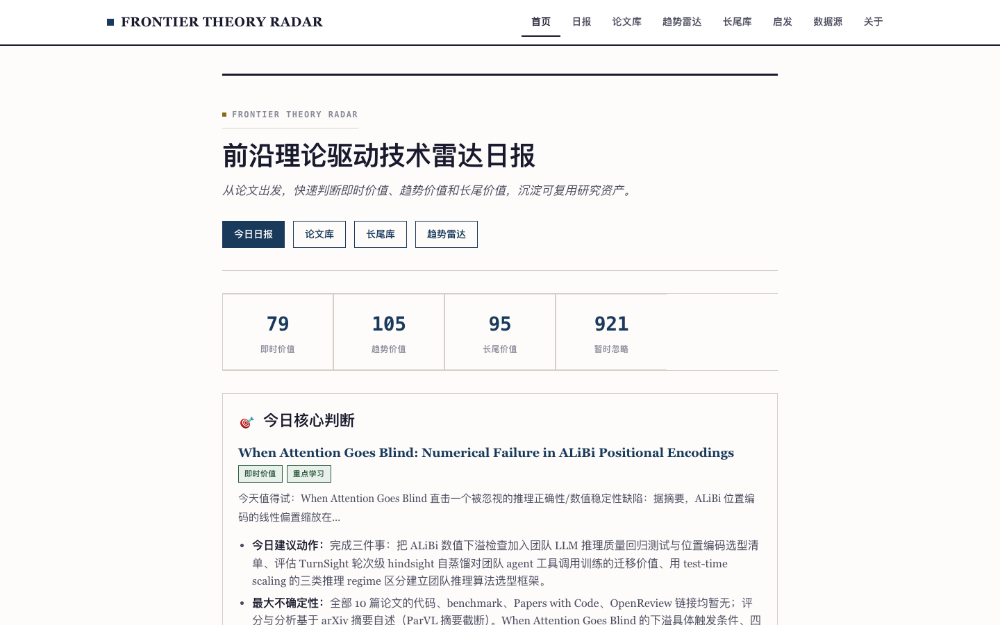
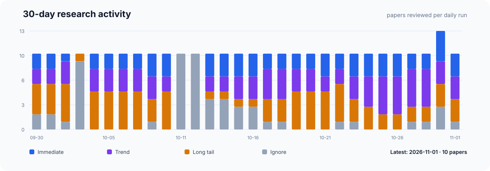
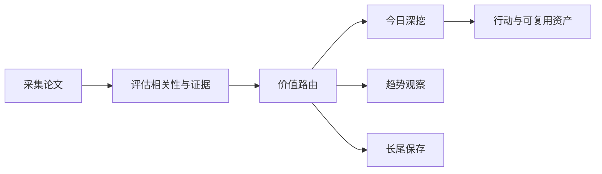

# 前沿理论驱动技术雷达

<h3 align="center">用可追溯证据判断：哪些前沿 AI 论文现在值得行动、哪些值得观察、哪些应当暂缓。</h3>

<p align="center">
  每日完成论文采集、价值路由、深度判断与趋势沉淀，区分即时价值、趋势价值、长尾价值与噪声。
</p>

<p align="center">
  <a href="README.md">English</a> ·
  <a href="https://radar.aiutil.com">在线雷达</a> ·
  <a href="https://radar.aiutil.com/daily.html">日报</a> ·
  <a href="https://radar.aiutil.com/about.html">研究方法</a>
</p>

<p align="center">
  <a href="https://github.com/aiutil/frontier-theory-radar/actions/workflows/ci.yml"></a>
  <a href="LICENSE"></a>
  
</p>



## 最新研究 · 2026-11-02

| 审阅论文 | 即时价值 | 趋势价值 | 长尾价值 | 暂时忽略 |
| ---: | ---: | ---: | ---: | ---: |
| 10 | 166 | 264 | 269 | 1364 |

**今日深挖：** [Elucidating the Design Space of LM Data Attribution](daily/2026/2026-11-02.md) · 即时价值 · 重点学习

**核心判断：** 它指出数据归因领域一个此前被默认掉的结构性缺陷：**归因方法的失败被评测设计掩盖了**——现有评测同时改变多个数据集属性，于是没人说得清"到底是算法不行，还是评测把难度调乱了"。作者提出 CATT：在完全虚构的知识上微调 LLM 给出无歧义 ground truth，再一次只改一个配置项。★ **今日用作者自己发布的分数文件 + 作者自己的 metrics 代码独立复算**：论文 Figure 4 的四臂**逐臂复现成功**——CE 全 token 0.0065（论文 0.01）、**CE top-10 0.2976（论文 0.30，这一臂作者根本没发布，今日用作者的 `token_aggregation` 从 472MB per-token terms 重建）**、nlo 全 token 0.3485（论文 0.35）、nlo+top-10 1.0000（论文 1.00）。

**建议动作：** 今天做三件事，前两件不依赖论文任何数字：(1) 把 CATT 的『评测变量解耦 + nlo 损失 + top-k 聚合』写成一条可执行的评测检查项，并在自有数据上试一次 nlo + top-k 聚合（对照均值聚合），**同时把两个修正的适用边界分开记**：nlo 管无干扰场景，top-k 管抗干扰场景；(2) 在 agent 防御方案清单里增加『显式决策 token span + 规则化自校验』这一选项，与『再训一次模型』『改架构』并列——ShallowDefend 的方法论今天就能用，不依赖它的代码（今日复核仍无官方实现）；(3) 读 logit-psv 今日新增的 `tests/` 与 `reproduce/` 目录，确认我们自托管的开放权重模型上能否挂 logits hook，并在 OLMo-3-7B-Instruct 或等效开放权重模型上做一次 MATH-500 的最小复现（63.3% → 81.3% 为作者自述，需自行验证），同时明确记录该路径对闭源 API 不可用这一前提。



## 最近 7 期日报

| 日期 | 深挖论文 | 价值类型 | 判断 |
| --- | --- | --- | --- |
| [2026-11-02](daily/2026/2026-11-02.md) | Elucidating the Design Space of LM Data Attribution | 即时价值 | 重点学习 |
| [2026-11-01](daily/2026/2026-11-01.md) | Elucidating the Design Space of LM Data Attribution | 即时价值 | 重点学习 |
| [2026-10-30](daily/2026/2026-10-30.md) | Heads of Security: Learned Attention Gates Improve Prompt Injection Robustness | 即时价值 | 重点学习 |
| [2026-10-28](daily/2026/2026-10-28.md) | I-HITL: Inalienable Human-in-the-Loop | 即时价值 | 重点学习 |
| [2026-10-27](daily/2026/2026-10-27.md) | Measure Before You Train: Typed Decision Models vs. a Classical Baseline vs. a Generative LLM for Routing a Personal Multilingual Inbox | 即时价值 | 重点学习 |
| [2026-10-26](daily/2026/2026-10-26.md) | EpiSEM-Bench: Evaluating Safety and Evidence Recovery in LLM Agents under Missing Evidence | 即时价值 | 重点学习 |
| [2026-10-25](daily/2026/2026-10-25.md) | EpiSEM-Bench: Evaluating Safety and Evidence Recovery in LLM Agents under Missing Evidence | 即时价值 | 重点学习 |

## 当前重点趋势

| 方向 | 阶段 | 关联论文 |
| --- | --- | ---: |
| [Agentic World Modeling](https://radar.aiutil.com/trend-detail.html?id=agentic-world-modeling) | 上升 | 623 |
| [Coding Agent](https://radar.aiutil.com/trend-detail.html?id=coding-agent) | 主流化 | 661 |
| [Context Engineering](https://radar.aiutil.com/trend-detail.html?id=context-engineering) | 上升 | 623 |

## 为什么做这个项目

论文聚合站通常优化“新”和“热”，本项目优化“判断”：哪些值得今天试验，哪些需要连续观察，哪些虽然不热但应该保留，哪些证据不足应明确暂缓。每个结论都保留来源，并写清当前最大不确定性。

## 研究工作流



- `papers/`：按日期保存来源快照和评分候选。
- `daily/`：保存每次研究运行的人类可读判断记录。
- `trends/`、`insights/`：沉淀跨日趋势与可复用发现。
- `docs/data/`：在线站点使用的结构化公开投影。
- `scripts/generate_readme.py`：从已提交证据生成双语 README 和活动图表。

## 证据边界

评分与结论属于研究判断，不等于独立复现。论文摘要、作者自述 Benchmark、开源实现与第三方复现是不同证据等级。代码缺失、摘要截断或 Benchmark 未核验时，会明确标注，不把推断包装成事实。

## 本地运行与验证

```bash
./run_daily.sh 2026-08-07
python3 -m pytest tests
python3 scripts/generate_readme.py
```

生产定时任务运行在 AIUtil 私有自动化环境中，凭据和私有运行记忆不进入本仓库。生成后的 Markdown、SVG、JSON 和来源链接均可通过 Git 历史审阅。

## 安全

请勿提交数据源凭据、API Token、私有论文集合或运营记忆。安全问题请通过 [GitHub Security Advisories](https://github.com/aiutil/frontier-theory-radar/security/advisories/new) 私下报告。

## 开源协议

Apache License 2.0，详见 [NOTICE](NOTICE)。
