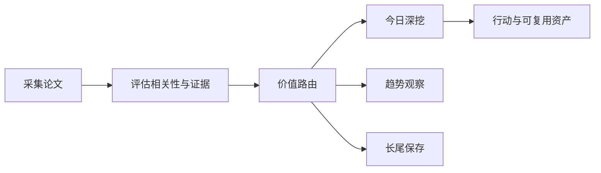

# 前沿理论驱动技术雷达

<h3 align="center">用可追溯证据判断：哪些前沿 AI 论文现在值得行动、哪些值得观察、哪些应当暂缓。</h3>

<p align="center">
  每日完成论文采集、价值路由、深度判断与趋势沉淀，区分即时价值、趋势价值、长尾价值与噪声。
</p>

<p align="center">
  <a href="README.md">English</a> ·
  <a href="https://radar.aiutil.com">在线雷达</a> ·
  <a href="https://radar.aiutil.com/daily.html">日报</a> ·
  <a href="https://radar.aiutil.com/about.html">研究方法</a>
</p>

<p align="center">
  <a href="https://github.com/aiutil/frontier-theory-radar/actions/workflows/ci.yml"></a>
  <a href="LICENSE"></a>
  
</p>


## 最新研究 · 2026-10-30

| 审阅论文 | 即时价值 | 趋势价值 | 长尾价值 | 暂时忽略 |
| ---: | ---: | ---: | ---: | ---: |
| 13 | 163 | 261 | 266 | 1363 |

**今日深挖：** [Heads of Security: Learned Attention Gates Improve Prompt Injection Robustness](daily/2026/2026-10-30.md) · 即时价值 · 重点学习

**核心判断：** 据 arXiv 2610.37657 摘要与 LaTeXML HTML 全文（今日回原文逐字复核，136.9KB 正文可读）以及官方仓库 github.com/imperial-aisp/heads_of_security 的本地下载与实跑：这篇给了一个**可判定的安全性质**，并把它做成了**今天就能接进服务的资产**。机制是：把输入 token 标注为可信 / 不可信 / 对话模板三类通道，为每个注意力头学习一组门，门在训练后学会压低不可信 token 的注意力权重、保留可信与模板 token，从而让模型能读懂不可信内容但不执行其中的指令。作者自述（今日不可复现）：黑盒 RL-Hammer 攻击对 GPT-OSS-20B 达到 **97% ASR**、对 SecAlign 达到 85%，**对 HoS 只有 10%**；白盒攻击 Claudini 经 autoresearch 针对 HoS 强化后，达到同等 ASR 所需 FLOPs 是打另外两者的 **3 倍**。效用侧没有牺牲：5-shot MMLU-Pro 上 HoS **67%** vs 基座 68%，而 SecAlign 与 ASIDE 掉到 59% 与 52%；Llama-3.3-70B 上 HoS 55% vs 基座 56%，SecAlign 掉到 16%。在 AgentDojo / AgentDyn / LLMail-Inject / WASP 上 HoS 与 SecAlign 相当且显著降低 ASR，而 ASIDE 在 tool use 上几乎不可用（三个 benchmark 接近 0 效用，AgentDojo 仅 10%）。★ **今日证据等级是本批最高的**（这是今天排第一的真正理由，不是分数）：官方仓库今日拉下（main 分支，3.44MB，MIT，created 2026-09-25，pushed 2026-10-28），仓库自带训练好的门权重，今日用 safetensors 逐一读取核对——gpt-oss-20b 四个学习率版本各 48 个 tensor、**合计 18,432 个参数**；llama-3.3-70b-instruct 版本 80 个 tensor、**合计 46,080 个参数**，tensor 名为 model.layers.N.self_attn.head_gates / sink_gates，与论文主张及 gates/README.md 自述的『GPT-OSS gates contain about 18,000 parameters per file; Llama gates contain about 46,000』**逐项吻合**。另有一处关键工程细节：gpt-oss 架构的注意力行带 sink logit，注意力行**不严格和为 1**，因此均匀门并不等价于恒等变换（仓库 tests/utils.py 的 ARCHS_WITH_SINKS 专门标注了这点）——这是把『门』做对、而不只是做出来的分水岭。

**建议动作：** 今天做三件不依赖论文任何数字的事：(1) 下载 HoS 的 gates/gpt-oss-20b/lr0.1/gates.safetensors，用 load_gated_model_local 加载，在只读工具调用沙箱上验证注意力门在我们自己的 prompt 模板上是否生效；(2) 把『注意力门 / 信任通道标注』写进防御方案清单，作为『再训一次模型』之外的第三选项；(3) 把三条今日判断写进检查表——防御的落点可以是注意力怎么分配；反思式优化前先过滤归因不成立的失败并保留成功轨迹；批次分配要同时看信息量与覆盖度。


## 最近 7 期日报

| 日期 | 深挖论文 | 价值类型 | 判断 |
| --- | --- | --- | --- |
| [2026-10-30](daily/2026/2026-10-30.md) | Heads of Security: Learned Attention Gates Improve Prompt Injection Robustness | 即时价值 | 重点学习 |
| [2026-10-28](daily/2026/2026-10-28.md) | I-HITL: Inalienable Human-in-the-Loop | 即时价值 | 重点学习 |
| [2026-10-27](daily/2026/2026-10-27.md) | Measure Before You Train: Typed Decision Models vs. a Classical Baseline vs. a Generative LLM for Routing a Personal Multilingual Inbox | 即时价值 | 重点学习 |
| [2026-10-26](daily/2026/2026-10-26.md) | EpiSEM-Bench: Evaluating Safety and Evidence Recovery in LLM Agents under Missing Evidence | 即时价值 | 重点学习 |
| [2026-10-25](daily/2026/2026-10-25.md) | EpiSEM-Bench: Evaluating Safety and Evidence Recovery in LLM Agents under Missing Evidence | 即时价值 | 重点学习 |
| [2026-10-24](daily/2026/2026-10-24.md) | EpiSEM-Bench: Evaluating Safety and Evidence Recovery in LLM Agents under Missing Evidence | 即时价值 | 重点学习 |
| [2026-10-23](daily/2026/2026-10-23.md) | LongZero: Enhancing Long-Context Reasoning in LLMs from Zero Data | 即时价值 | 重点学习 |

## 当前重点趋势

| 方向 | 阶段 | 关联论文 |
| --- | --- | ---: |
| [Agentic World Modeling](https://radar.aiutil.com/trend-detail.html?id=agentic-world-modeling) | 上升 | 622 |
| [Coding Agent](https://radar.aiutil.com/trend-detail.html?id=coding-agent) | 主流化 | 656 |
| [Context Engineering](https://radar.aiutil.com/trend-detail.html?id=context-engineering) | 上升 | 622 |

## 为什么做这个项目

论文聚合站通常优化“新”和“热”，本项目优化“判断”：哪些值得今天试验，哪些需要连续观察，哪些虽然不热但应该保留，哪些证据不足应明确暂缓。每个结论都保留来源，并写清当前最大不确定性。

## 研究工作流



- `papers/`：按日期保存来源快照和评分候选。
- `daily/`：保存每次研究运行的人类可读判断记录。
- `trends/`、`insights/`：沉淀跨日趋势与可复用发现。
- `docs/data/`：在线站点使用的结构化公开投影。
- `scripts/generate_readme.py`：从已提交证据生成双语 README 和活动图表。

## 证据边界

评分与结论属于研究判断，不等于独立复现。论文摘要、作者自述 Benchmark、开源实现与第三方复现是不同证据等级。代码缺失、摘要截断或 Benchmark 未核验时，会明确标注，不把推断包装成事实。

## 本地运行与验证

```bash
./run_daily.sh 2026-08-07
python3 -m pytest tests
python3 scripts/generate_readme.py
```

生产定时任务运行在 AIUtil 私有自动化环境中，凭据和私有运行记忆不进入本仓库。生成后的 Markdown、SVG、JSON 和来源链接均可通过 Git 历史审阅。

## 安全

请勿提交数据源凭据、API Token、私有论文集合或运营记忆。安全问题请通过 [GitHub Security Advisories](https://github.com/aiutil/frontier-theory-radar/security/advisories/new) 私下报告。

## 开源协议

Apache License 2.0，详见 [NOTICE](NOTICE)。
