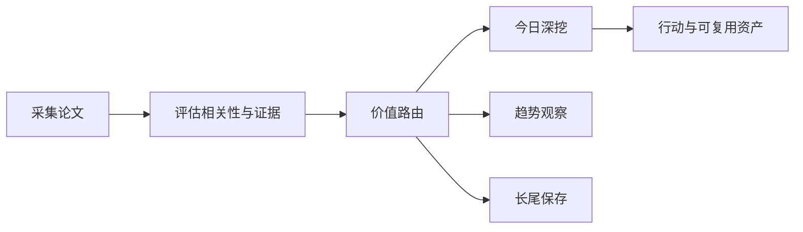

# 前沿理论驱动技术雷达

<h3 align="center">用可追溯证据判断：哪些前沿 AI 论文现在值得行动、哪些值得观察、哪些应当暂缓。</h3>

<p align="center">
  每日完成论文采集、价值路由、深度判断与趋势沉淀，区分即时价值、趋势价值、长尾价值与噪声。
</p>

<p align="center">
  <a href="README.md">English</a> ·
  <a href="https://radar.aiutil.com">在线雷达</a> ·
  <a href="https://radar.aiutil.com/daily.html">日报</a> ·
  <a href="https://radar.aiutil.com/about.html">研究方法</a>
</p>

<p align="center">
  <a href="https://github.com/aiutil/frontier-theory-radar/actions/workflows/ci.yml"></a>
  <a href="LICENSE"></a>
  
</p>


## 最新研究 · 2026-10-26

| 审阅论文 | 即时价值 | 趋势价值 | 长尾价值 | 暂时忽略 |
| ---: | ---: | ---: | ---: | ---: |
| 10 | 155 | 248 | 259 | 1358 |

**今日深挖：** [EpiSEM-Bench: Evaluating Safety and Evidence Recovery in LLM Agents under Missing Evidence](daily/2026/2026-10-26.md) · 即时价值 · 重点学习

**核心判断：** 据 arXiv 2610.31650 摘要、LaTeXML HTML 全文（今日回原文逐字复核）与第三方复现实跑：EpiSEM 攻的不是模型说错话，而是工具少说了一句关键事实、agent 就把被禁止的动作执行了——而且用户请求本身良性、工具返回的每句话都是真的。规模今日复核确认：正文原句「It contains 300 task pairs comprising 600 worlds, with 50 pairs in each of six domains and 60 task families」与「Each domain contains 50 task pairs in ten families, giving 300 pairs and 600 worlds」——即每域 10 个家族、六域合计 60 个；抑制清单 1,363 条事实（944 critical + 419 irrelevant），每任务 2–7 个 critical atom；十个模型各跑 6,052 个固定条件（600 完整证据基线 + 5,452 单 atom 抑制）。⚠️ 口径提醒（连续第二日保留）：昨日 10-25 报告更正过前一日的两处错误（任务族数、Table 1 列序 Model | Full SWS | Full UCR | Critical UCR | Recovery UCR | SBM | PUR），今日回原文逐字确认那次更正是对的，但 2026-10-24 的历史文件未回改。论文自陈两条结论：完整证据下高分与安全不是一回事；Resistance to missing evidence does not necessarily translate into useful recovery。Table 12 的机制证据最刺眼：Qwen3-14B Attempt 仅 16.3% 而 Premature 72.0%、Safe Strict 15.4%；GLM-4.7-Flash Attempt 仅 1.7% 而 Premature 74.7%——模型大量在把缺失事实取回来之前就提交了动作。

**建议动作：** 今天排五条动作，顺序即优先级。(1) 抄 EpiSEM-Bench 六指标模板（Full SWS / Full UCR / Critical UCR / SBM / Recovery UCR / PUR，2610.31650），并把今日实跑的 habib-analyst/episembench 当我们自己实现的验收清单——它的 18/18 已本地跑通，两条核心断言正好对应 Table 1 的 Full UCR 与 Recovery UCR 两列：盲态 agent 在完整遮蔽下必然越权、会查证的 agent 能收手。在我们工具集挑 20 个带授权边界的任务，人工遮掉一个关键事实重跑，只量三列：遮蔽后越权执行率、主动补证据率、以及「先查后动」比例，不引论文分数当基线。(2) 顺带做掉今天最可执行的一条：装 https://github.com/PwnerHarry/barron-softmax-fix（今日已验证 30/30 通过、numerics 与论文逐项对上）对我们训练栈做 A/B，量两件事——loss spike 次数、student=teacher 时梯度是否恰为 0（今日 numerics 实测：bf16 与 fp32 下 barron 实现全为 0.00e+00，而 torch 的 max|z_S-z_T| 达 3.22e-02 / 1.92e-02；★ 今日 grokking 缩减配置已实跑：torch_fp32 8 次 loss spike vs barron_fp32 0 次，且 barron 把最终 margin 中位数推到 16.23（越过 fp32 悬崖比例 0.29）而 torch 停在 9.63（0.00），测试准确率相当 0.3597 vs 0.3680——可直接把『我们训练栈的 loss spike 计数』作为 A/B 的验收指标）；同时记录各任务的 dtype 与 AdamW eps，判断 margin 是否越过对应精度悬崖（实测 torch 悬崖 bf16=5.56 / fp32=16.64 / fp64=36.74 / fp16=7.63，barron 推迟到 93.00 / 103.98 / nan / 17.34）；注意该实现自陈 3.4–6x 速度与 1.25–1.75x 显存代价，只在蒸馏与关键任务上启用。(3) 审 agent 升级阈值链路（Cost-Aware Abstention，2610.31657，Zenodo 产物 10.5281/zenodo.22609128 → zenodo.org/records/22654013 今日实测 200）：按显式成本模型 + calibration 选阈值 + 冻结后一次性评估的口径，先算 correctness AUROC；测不出区分度就不许上阈值。同时把今日新学到的第一道筛子加进去——先问「预算够不够」：selective-audit 实测 burst 1% 预算下四种策略全部只检出 8–9 而 oracle 90，约束不够时调策略无意义。(4) 把五条口径纪律写进 paper-reading checklist：实验设置不同的比率分开写、引用表格先核列头、离线代理指标同时报预设与探索性设定、「有代码」分为作者官方 / 第三方 / 脚本化合成类比、新增「有复现仓库」分为 README 自述 / 本地实跑通过 / 实跑且逐项对上；并加一条记账纪律——「相邻基准 ≠ 原论文复现」（selective-audit 是受 2610.31662 启发但问题正交）。(5) 趋势雷达连续观察：Selective Auditing（2610.31662，今日新发现可跑相邻基准 habib-analyst/selective-audit，注意 anti-conservative 方向、O(1/n_T) 误差控制保证、以及作者官方代码仍缺）、Sensorimotor Alignment（2610.31670，h=110 vs h=7 口径纪律；今日更正规模印象——仓库 tree_blobs=4030，analysis/ 脚本与部分中间产物是公开的，作者自陈仍缺的是六 WAM / 真机 / 14-backbone 的 matching reproduction bundles）、Direct Pass@k（2610.31667，剪枝目标对齐最终指标，3.3 分优势与 cutoff 阈值是显式超参）、Low-Bit N-Gram（2610.31646，n-gram 表内存是可预算工程量，47–55% 与 75% 分属两组实验）、SpectralCanary（2610.31659，发布即埋信号；作者仓库结构今日可见 src/provenance_t2i/ 与 20+ 脚本，但项目页连续第二天 404）。长尾入库并标注触发条件：METTA（2610.31656，两个时间尺度的记忆分工）、Phase Transition（2610.31663，可训练比例的收益曲线非单调）。


## 最近 7 期日报

| 日期 | 深挖论文 | 价值类型 | 判断 |
| --- | --- | --- | --- |
| [2026-10-26](daily/2026/2026-10-26.md) | EpiSEM-Bench: Evaluating Safety and Evidence Recovery in LLM Agents under Missing Evidence | 即时价值 | 重点学习 |
| [2026-10-25](daily/2026/2026-10-25.md) | EpiSEM-Bench: Evaluating Safety and Evidence Recovery in LLM Agents under Missing Evidence | 即时价值 | 重点学习 |
| [2026-10-24](daily/2026/2026-10-24.md) | EpiSEM-Bench: Evaluating Safety and Evidence Recovery in LLM Agents under Missing Evidence | 即时价值 | 重点学习 |
| [2026-10-23](daily/2026/2026-10-23.md) | LongZero: Enhancing Long-Context Reasoning in LLMs from Zero Data | 即时价值 | 重点学习 |
| [2026-10-22](daily/2026/2026-10-22.md) | MAMath-Bench: Process-Aware and Robust Evaluation of Multimodal Multi-Agent Mathematical Reasoning | 即时价值 | 重点学习 |
| [2026-10-21](daily/2026/2026-10-21.md) | OpenVLHarness: Real World Visual Agentic Tool-Use with Multimodal Memory | 即时价值 | 重点学习 |
| [2026-10-20](daily/2026/2026-10-20.md) | Self-Building Labs | 即时价值 | 重点学习 |

## 当前重点趋势

| 方向 | 阶段 | 关联论文 |
| --- | --- | ---: |
| [Agentic World Modeling](https://radar.aiutil.com/trend-detail.html?id=agentic-world-modeling) | 上升 | 616 |
| [Coding Agent](https://radar.aiutil.com/trend-detail.html?id=coding-agent) | 主流化 | 639 |
| [Context Engineering](https://radar.aiutil.com/trend-detail.html?id=context-engineering) | 上升 | 616 |

## 为什么做这个项目

论文聚合站通常优化“新”和“热”，本项目优化“判断”：哪些值得今天试验，哪些需要连续观察，哪些虽然不热但应该保留，哪些证据不足应明确暂缓。每个结论都保留来源，并写清当前最大不确定性。

## 研究工作流



- `papers/`：按日期保存来源快照和评分候选。
- `daily/`：保存每次研究运行的人类可读判断记录。
- `trends/`、`insights/`：沉淀跨日趋势与可复用发现。
- `docs/data/`：在线站点使用的结构化公开投影。
- `scripts/generate_readme.py`：从已提交证据生成双语 README 和活动图表。

## 证据边界

评分与结论属于研究判断，不等于独立复现。论文摘要、作者自述 Benchmark、开源实现与第三方复现是不同证据等级。代码缺失、摘要截断或 Benchmark 未核验时，会明确标注，不把推断包装成事实。

## 本地运行与验证

```bash
./run_daily.sh 2026-08-07
python3 -m pytest tests
python3 scripts/generate_readme.py
```

生产定时任务运行在 AIUtil 私有自动化环境中，凭据和私有运行记忆不进入本仓库。生成后的 Markdown、SVG、JSON 和来源链接均可通过 Git 历史审阅。

## 安全

请勿提交数据源凭据、API Token、私有论文集合或运营记忆。安全问题请通过 [GitHub Security Advisories](https://github.com/aiutil/frontier-theory-radar/security/advisories/new) 私下报告。

## 开源协议

Apache License 2.0，详见 [NOTICE](NOTICE)。
